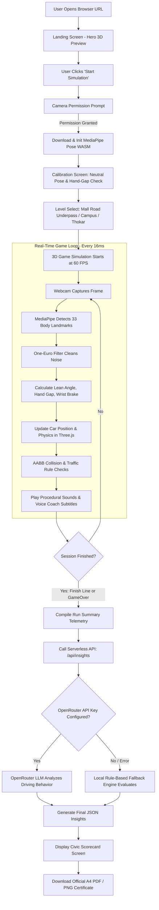
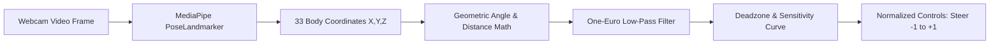
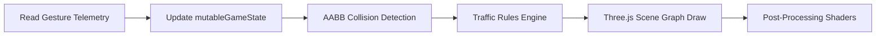

# 🚗 GestureKart — Complete Project Theory, Architecture & Flow Guide
> **Dastavez Ka Maqsad:** Is document mein GestureKart ka mukammal theoretical aur technical architecture, frontend/backend ka structure, pipeline ka concept, aur AI ki working aasan Roman Urdu + English technical terms mein samjhayi gayi hai taakay aap viva, presentation, ya self-study ke liye har cheez ko gehraai se samajh sakein.

---

## 📑 Feharist (Table of Contents)
1. [Project Ka Khulasa (Executive Summary)](#1-project-ka-khulasa-executive-summary)
2. [End-to-End System Flow (Khel Ka Aaghaz Se Ikhtitam Tak Ka Rasta)](#2-end-to-end-system-flow)
3. [Frontend Kahan Hai Aur Kya Kaam Karta Hai?](#3-frontend-kahan-hai-aur-kya-kaam-karta-hai)
4. [Backend Kahan Hai Aur Kya Kaam Karta Hai?](#4-backend-kahan-hai-aur-kya-kaam-karta-hai)
5. [Pipeline Kya Hoti Hai Aur Is Project Mein Kahan Kahan Use Ho Rahi Hai?](#5-pipeline-kya-hoti-hai-aur-is-project-mein-kahan-use-ho-rahi-hai)
6. [AI Ki Working (AI Kahan Hai Aur Kaise Kaam Karta Hai?)](#6-ai-ki-working)
7. [Data Storage & State Management (Data Kahan Rehta Hai?)](#7-data-storage--state-management)
8. [Viva & Exam Quick Revision Cheat Sheet](#8-viva--exam-quick-revision-cheat-sheet)

---

## 1. Project Ka Khulasa (Executive Summary)

**GestureKart** aik interactive 3D Traffic Simulation game hai jo **Lahore Canal Road** ke traffic environment par bani hai. Is project ka markazi maqsad Pakistan mein road safety aur driving rules ki awareness barhana hai.

### Is Project Ki Khaas Batain:
1. **No Keyboard/Mouse Needed (Primary):** Player car ko chalane ke liye kisi physical steering wheel ya keyboard ka mohtaaj nahi hai. Player apne **laptop/webcam ke samne khare ya beth kar physical gestures (body movement)** se car drive karta hai.
2. **Pakistani Urban Traffic Elements:** Is simulation mein aam Pakistani traffic jaise ke Auto-Rickshaws, Suzuki Bolan ("Dabba"), Lahore Metro Buses, zebra-crossing par pedestrians (paidal chalne wale), aur Canal Road ke 3-phase traffic signals shamil hain.
3. **Civic Driving Score:** Player ko shuru mein 1000 points milte hain. Red light torna, lane straddling (line par chalna), speeding, ya collision par points katte hain.
4. **AI-Powered Evaluation:** Game khatam hone par AI (Large Language Model) player ki driving telemetry analyze karta hai aur use aik personalized report card (PDF/PNG) deta hai.

---

## 2. End-to-End System Flow

Yeh flow chart dikhata hai ke jab aik user browser kholta hai to step-by-step kya hota hai:



### Flow Ki Step-by-Step Tafseel:
1. **Initialization:** User website par ata hai. Background mein lightweight 3D procedural Canal Road render ho rahi hoti hai.
2. **Camera Access & ML Loading:** Jab user click karta hai to browser camera permission mangta hai. Usi waqt `@mediapipe/tasks-vision` ka pre-trained vision model Google CDN se browser ke WebAssembly (WASM) cache mein load hota hai.
3. **Calibration:** User apna normal stance set karta hai taakay camera user ki height aur seating position ko samajh sake.
4. **In-Game Driving Loop (60 FPS):** Webcam har frame ko capture karta hai, model body points extract karta hai, filter jhatkay khatam karta hai, Three.js car ko steer karta hai, aur traffic rules check hote hain.
5. **End-of-Run Evaluation:** Jab drive complete hoti hai, game ka summary data backend API ko bheja jata hai jahan AI analyze karke driving report tayar karta hai.

---

## 3. Frontend Kahan Hai Aur Kya Kaam Karta Hai?

Is project ka taqreeban **85% se 90% logic client-side (Frontend)** par chalta hai. Iski wajah yeh hai ke real-time video processing aur 60 FPS 3D rendering server par nahi ki ja sakti (latency aur bandwidth ki wajah se).

### 📂 Frontend Ka Folder:
Frontend sara ka sara `src/` directory mein mojood hai:

| Folder / File Path | Zimadari (Responsibility) | Technology |
|---|---|---|
| `src/main.tsx` | React 18 ka entry point jahan DOM mount hoti hai. | React 18 |
| `src/App.tsx` | Main application controller jo screens (Landing, Game, Calibration, GameOver wagera) ko switch karta hai. | React, Zustand |
| `src/cv/` | **Computer Vision Engine:** MediaPipe pose loader, gesture parser, One-Euro low pass filter. | `@mediapipe/tasks-vision`, WebAssembly |
| `src/game/scene/` | **3D World:** Car, Road, Canal water, Traffic (Rickshaw, Bus, Mehran), Traffic Signals, Trees, Lighting. | Three.js, `@react-three/fiber` (R3F), Drei |
| `src/game/systems/` | Collision detection (AABB), Traffic Rule evaluation (Red light, Lane discipline), Points tally. | Pure TypeScript |
| `src/game/store.ts` | Game ki state (Score, Level, Active Screen, Settings) manage karna. | Zustand + MutableGameState |
| `src/components/hud/` | Driving ke doraan aane wala UI: Speedometer arc, Points counter, Signal alerts, Camera PiP. | Tailwind CSS, Framer Motion |
| `src/audio/` | Engine ki awaz, horn, indicator, collision sound, aur Voice coach. | Web Audio API (Synthesizer), Web Speech API |
| `src/report/` | Driving ka official PDF certificate aur PNG social card generate karna. | `jsPDF`, `html2canvas` |

### Frontend Ki Teen Barri Khaasiyatain:
1. **Procedural Zero-Asset 3D:** Is project mein bahar se koi bhaari 50MB ki 3D `.gltf` ya `.obj` model files download nahi ki jaati! Har gaari (Rickshaw, Mehran, Bus), darakht, aur road Three.js ke geometric primitives (Boxes, Cylinders, Extrusions) se runtime par code ke zariye generate hoti hai. Is wajah se website 1 second mein load ho jati hai.
2. **Procedural Audio:** Koi `.mp3` ya `.wav` files load nahi hoti. Web Audio API ke oscillators aur filters mathematical sine/sawtooth waves se engine revving aur horns generate karte hain.
3. **Decoupled Architecture (Do Alag Threads):** MediaPipe camera processing aur Three.js rendering alag alag loops par chalti hain taakay agar camera thora slow bhi ho, game ka frame rate 60 FPS par smooth rahe.

---

## 4. Backend Kahan Hai Aur Kya Kaam Karta Hai?

Aam tor par log samajhte hain ke backend ke liye hamesha aik alag se chalti hui Express/Node.js ya Django/Flask server app lazmi hoti hai. Lekin modern architecture mein hum **Serverless Functions** use karte hain.

### 📂 Backend Ka Folder:
Backend ka sara code project ki root mein mojood `api/` folder ke andar hai:

```
api/
├── insights.ts             # Main End-of-Run Driving Evaluation endpoint
├── hint.ts                 # Real-time safety hints endpoint
└── _lib/
    ├── openrouter.ts       # OpenRouter LLM API client wrapper
    ├── schema.ts           # Zod input & output validation schemas
    ├── rateLimit.ts        # In-memory IP-based rate limiter
    ├── prompts.ts          # Structured System & User Prompts
    ├── fallback.ts         # Guaranteed rule-based fallback logic
    └── types.ts            # Request & Response TypeScript interfaces
```

### Backend Ki Zimadariyaan (Responsibilities):
1. **Secure API Key Protection:** Agar hum OpenRouter ki API key frontend (`src/`) mein likh dete, to koi bhi user browser ke Inspect Element / Network tab se key chura sakta tha. Backend proxy (`api/insights.ts`) key ko server-side environment variables (`process.env.OPENROUTER_API_KEY`) mein mehfooz rakhta hai.
2. **Rate Limiting (`api/_lib/rateLimit.ts`):** Yeh check karta hai ke koi malicious user baar baar API call karke hamara AI quota khatam na kar de (Max 20 requests per minute per IP).
3. **Schema Validation (`api/_lib/schema.ts`):** Zod library ke zariye ensure karta hai ke frontend se aane wala data (score, violations, distance) bilkul theek format mein ho.
4. **AI Communication (`api/_lib/openrouter.ts`):** Backend server OpenRouter API ko call karta hai, aur sath 8-second ka `AbortController` timeout lagata hai taakay agar internet slow ho to game freeze na ho.
5. **Fail-Safe Fallback (`api/_lib/fallback.ts`):** Agar user ke paas API key na ho, internet chala jaye, ya AI server down ho jaye, to backend crash hone ke bajaye foran deterministic rule-based analysis return karta hai.

---

## 5. Pipeline Kya Hoti Hai Aur Is Project Mein Kahan Use Ho Rahi Hai?

### Pipeline Ka Asal Concept (Theory):
> **Definition:** Software Engineering aur Computer Science mein **"Pipeline"** aik aise silsilay (sequence) ko kehte hain jahan data mutadad marhalon (stages) se guzar kar process hota hai. Pehle marhale ka **Output**, agle marhale ka **Input** banta hai:
> 
> $$\text{Raw Input} \longrightarrow [\text{Stage 1}] \longrightarrow [\text{Stage 2}] \longrightarrow [\text{Stage 3}] \longrightarrow \text{Final Result}$$

Is GestureKart project mein **5 Mukhtalif Pipelines** kaam kar rahi hain:

---

### Pipeline #1: Computer Vision & Gesture Pipeline (Vision Pipeline)
Yeh pipeline webcam ke raw pixels ko car ke steering aur speed controls mein tabdeel karti hai:



* **Stage 1 (Frame Grab):** Webcam se har 16ms baad video frame liya jata hai.
* **Stage 2 (Inference):** MediaPipe ka Deep Neural Network frame scan karke 33 normalized landmarks nikalta hai (Left/Right Shoulder, Wrist, Hips, Nose).
* **Stage 3 (Geometric Parsing):** 
  - **Steering:** Left shoulder aur Right shoulder ka slope $(\frac{y_2 - y_1}{x_2 - x_1})$ calculate hota hai jis se player ka lean angle nikalta hai.
  - **Brake:** Check hota hai ke kya Right wrist nose ki line se ooper uthi hui hai?
  - **Throttle (Speed):** Dono kalaiyon (wrists) ke darmiyan fasla $(\text{Euclidean Distance})$ calculate hota hai.
* **Stage 4 (Signal Filtering - One-Euro Filter):** Insaan ke jism mein choti choti thartharahat (tremors ya noise) hoti hai. One-Euro adaptive filter slow motion mein jitter ko smooth karta hai aur fast motion mein lag nahi aane deta.
* **Stage 5 (Control Mapping):** Aik $2.4^\circ$ ki deadzone lagayi jati hai taakay aam saans lene par gaari na ghoome. Uske baad normalized steering value $[-1.0, +1.0]$ car controller ko mil jati hai.

---

### Pipeline #2: 3D Graphics & Game Simulation Pipeline
Yeh pipeline game ki physics aur visuals ko 60 frames per second par chalati hai:



* **Stage 1 (State Injection):** Vision pipeline ka output `mutableGameState` mein inject hota hai.
* **Stage 2 (Physics & Kinematics):** Car ki acceleration, speed, aur lane drift calculate hoti hai.
* **Stage 3 (Collision System):** Har gaari aur pedestrian ke ird gird aik invisible **AABB (Axis-Aligned Bounding Box)** hoti hai. System check karta hai ke kya do boxes aapas mein overlap ho rahi hain?
* **Stage 4 (Rules Enforcement):** Traffic signals ka timer check hota hai. Agar light RED ho aur player stop-line cross kare to points katte hain.
* **Stage 5 (GPU Render):** WebGL buffer Three.js ke zariye screen par canal, pani ki waves, car body roll, aur traffic ko draw karta hai.

---

### Pipeline #3: AI Driving Insights Pipeline (LLM Pipeline)
Yeh pipeline driving session ke numeric data ko human-like driving evaluation report mein convert karti hai:

```mermaid
flowchart LR
    A[Telemetry Summary Object] --> B[insightsClient.ts POST]
    B --> C[/api/insights Serverless]
    C --> D[Zod Input Validation]
    D --> E[Prompt Assembly]
    E --> F[OpenRouter LLM Call]
    F --> G[Clean JSON & Zod Verification]
    G --> H[Final Report Card Display]
```

* **Stage 1 (Aggregation):** Game khatam hone par player ka score (e.g. 780), distance (1200m), aur violations ki list aik JavaScript object mein jama hoti hai.
* **Stage 2 (Transport):** `src/services/insightsClient.ts` fetch request ke zariye `/api/insights` ko payload bhejta hai.
* **Stage 3 (Validation & Security):** Serverless function request ki authenticity aur rate limit verify karta hai.
* **Stage 4 (Prompt Engineering):** System prompt aur User prompt combine hote hain jahan model ko "Lahore Traffic Safety Inspector" ka role diya jata hai aur strict JSON schema mangi jati hai.
* **Stage 5 (LLM Execution):** OpenRouter API ke zariye Llama-3.3-70B model ko query bheji jati hai.
* **Stage 6 (Response Parsing):** Output se markdown code fences hata kar JSON parse kiya jata hai aur UI ko return kar diya jata hai.

---

### Pipeline #4: Audio Synthesis & Speech Pipeline
* **Sound Generation:** `Web Audio API` AudioContext ke zariye oscillator nodes (sine/sawtooth waves) banata hai. Gaari ki speed ke hisaab se oscillator ki pitch increase ya decrease hoti hai (Doppler effect ki tarah).
* **Voice Coaching:** `Web Speech API` ke prioritized queue mein messages lagte hain. Agar "Danger" alert ho to woh aam tips ko preempt karke pehle bolta hai.

---

### Pipeline #5: Document & Certificate Generation Pipeline
* **HTML Render:** `ReportTemplate.tsx` A4 print dimensions ke mutabiq certificate render karta hai.
* **Rasterization:** `html2canvas` DOM elements ko capture karke high-resolution pixel canvas banata hai.
* **Vector Assembly:** `jsPDF` canvas ko multi-page ya single-page standard A4 PDF structure mein pack karke instant download initiate karta hai.

---

## 6. AI Ki Working

Is project mein **DO (2) Qism Ka AI** istemal ho raha hai. Viva aur presentation mein yeh farq batana bohot zaroori hai:

```
                      ┌────────────────────────────────────────┐
                      │          AI IN GESTUREKART             │
                      └──────────────────┬─────────────────────┘
                                         │
                 ┌───────────────────────┴───────────────────────┐
                 ▼                                               ▼
     ┌───────────────────────┐                       ┌───────────────────────┐
     │   1. Computer Vision  │                       │ 2. Generative AI (LLM)│
     │      (Perception)     │                       │      (Cognition)      │
     ├───────────────────────┤                       ├───────────────────────┤
     │ • MediaPipe Pose      │                       │ • OpenRouter API      │
     │ • Runs on Client (WASM)│                       │ • Llama-3.3-70B Model │
     │ • Real-time (60 FPS)  │                       │ • Runs on Cloud Server│
     │ • Privacy: Video stays│                       │ • Evaluates behavior  │
     │   inside your browser │                       │ • Generates feedback  │
     └───────────────────────┘                       └───────────────────────┘
```

### 1. Vision AI (Edge / Client-Side Machine Learning):
* **Model:** Google MediaPipe Tasks Vision (`PoseLandmarker Lite`).
* **Technology:** WebAssembly (WASM) + WebGL / WebGPU acceleration.
* **Kaam:** Yeh model camera ke samne khare insaan ke skeleton ke **33 3D Points** detect karta hai.
* **Privacy:** Koi bhi video ya tasveer kisi server par upload nahi hoti! Sara machine learning model player ke browser ke andar hi run hota hai.

### 2. Generative AI / LLM (Cloud Cognitive AI):
* **Provider:** OpenRouter API (`https://openrouter.ai/api/v1/chat/completions`).
* **Model:** Default: `meta-llama/llama-3.3-70b-instruct:free` (ya user ki pasand ka koi bhi model).
* **Kaam:** Yeh AI model game ke statistical telemetry data ko parhta hai aur insaan ki tarah tajziya karta hai:
  - Driver Personality title assign karta hai (e.g. *"The Impulsive Overtaker"*, *"Master of Canal Road"*).
  - Khususi violations par actionable driving tips deta hai.
  - Urdu/English mix tone mein motivating closing line likhta hai.

### 3. Rule-Based Fallback Engine (Symbolic AI):
Enterprise-grade software ki nishani hoti hai ke agar external third-party API fail ho jaye to software crash na ho. Agar OpenRouter down ho ya API key na ho, to `api/_lib/fallback.ts` aur `src/services/fallbackInsights.ts` foran rule-based logic chala kar realistic feedback provide karte hain.

---

## 7. Data Storage & State Management

Aksar poocha jata hai ke game ka data kahan save hota hai:

1. **Short-Term High-Frequency State (`mutableGameState`):**
   - Car ki position, rotation, speed, aur active signals har frame par tabdeel hote hain (1 second mein 60 dafa).
   - Agar hum iske liye standard React `useState` use karte to component 60 dafa re-render hota aur browser hang ho jata.
   - Is liye hum aik **Plain JavaScript Mutable Object Singleton** use karte hain jo Three.js ki `useFrame()` hook mein direct read/write hota hai (Zero garbage collection overhead).
2. **UI & Screen State (`Zustand Store`):**
   - Current screen (Landing, LevelSelect, GameOver), Score, Settings, aur Calibration data Zustand store mein rehta hai.
3. **Persistent Browser Storage (`localStorage`):**
   - Camera calibration offsets (neutral lean angle, sensitivity, volume preferences) browser ke `localStorage` mein mehfooz ho jate hain taakay agli dafa user ko dobara calibrate na karna paray.

---

## 8. Viva & Exam Quick Revision Cheat Sheet

Agar aap se viva ya presentation mein sawalat poochay jayen, to yeh direct mukhtasir jawabat yaad rakhein:

| Sawal (Question) | Mukhtasir Jawab (Quick Answer) |
|---|---|
| **1. Is project ka frontend kahan hai?** | Sara frontend `src/` folder mein hai. UI ke liye React + Tailwind CSS, 3D simulation ke liye Three.js (`@react-three/fiber`), aur state ke liye Zustand use hua hai. |
| **2. Iska backend kahan hai?** | Backend `api/` folder mein mojood Vercel Serverless Functions hain (`api/insights.ts`, `api/hint.ts`). Yeh Node.js/TypeScript mein likhi gayi hain. |
| **3. Pipeline kya hoti hai?** | Pipeline aik aisa software design pattern hai jahan raw input mutadad sequential stages se guzarta hai aur har stage ka output agle stage ka input banta hai. Is project mein 5 pipelines hain (Vision, 3D Render, AI Insights, Audio, aur PDF Export). |
| **4. AI kahan use ho rahi hai?** | Do jagah: (1) **MediaPipe Pose** (Vision AI) jo browser mein real-time body tracking karti hai. (2) **OpenRouter LLM** (Generative AI) jo game ke end par driver ki telemetry analyze karke customized feedback deti hai. |
| **5. Agar internet na ho ya OpenRouter key na ho to kya AI kaam karegi?** | Vision AI (MediaPipe) offline bhi chalegi kyunke model WASM cache mein hota hai. Driving feedback ke liye hamara local rule-based fallback engine activate ho jata hai jis se app kabhi crash nahi hoti. |
| **6. 3D models itni tezi se kaise load hote hain?** | Hamne bahar se bhaari `.gltf`/`.obj` files download nahi keen. Sara 3D world (Canal, Rickshaw, Car, Pedestrians) procedural primitives ke through code se runtime par generate hota hai. |
| **7. Jitter aur shaking kaise control hoti hai?** | Insaan ki qudrati body shaking ko khatam karne ke liye hamne **One-Euro Filter** implement kiya hai jo low speed par jitter smooth karta hai aur high speed par responsiveness barhata hai. |

---

> **Tayar Karda:** GestureKart Technical Documentation Team  
> **Reference File:** `PROJECT_THEORY_AND_ARCHITECTURE.md` (Located at project root)
