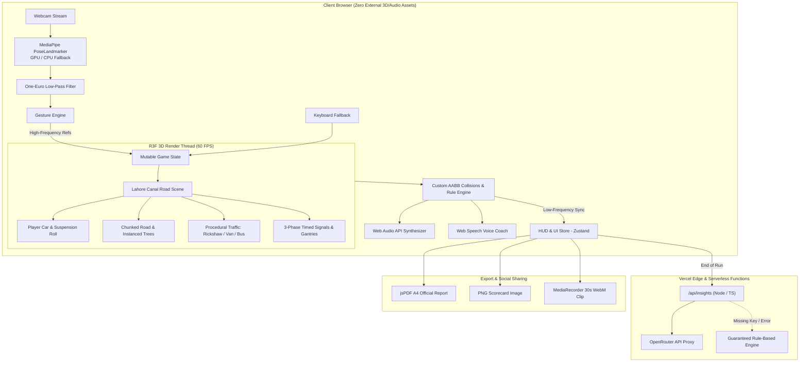

# 🚗 GestureKart — Physical-Gesture 3D Traffic Simulator

> **Drive with your body. Master the rules of Lahore Canal Road.**  
> A high-fidelity, webcam-controlled 3D traffic safety game ending in a verifiable **Civic Driving Score** report card (PDF + PNG).

[](https://vercel.com/new)
[](LICENSE)
[](https://threejs.org/)
[](https://developers.google.com/mediapipe)

---

## 📌 Executive Summary

Traditional road safety awareness campaigns in Pakistan struggle to engage young and first-time drivers. **GestureKart** turns traffic rule training into an immersive browser game where players navigate a stylized simulation of **Lahore Canal Road** using **ONLY physical body gestures** captured live through their webcam.

Players encounter real-world Pakistani urban driving scenarios: auto-rickshaws, Suzuki Bolan commuter vans, Lahore Metro city buses, pedestrians crossing at zebra crossings, and strict three-phase timed traffic signals. Every red-light crossing, reckless overtake, or speed violation is logged in real time. At the conclusion of each drive, players receive an official **Civic Driving Score** report card with personalized **Civic Insights** and actionable feedback.

---

## 📸 Screenshots & Showcase

| Hero & Mission Briefing | Natural Body Tracking (Webcam PiP) |
| :---: | :---: |
| *(Hero landing with live procedural 3D Canal Road background)* | *(Biometric tracking with glowing skeleton overlay & telemetry)* |

| In-Game Canal Road HUD | Downloadable Civic Score Card |
| :---: | :---: |
| *(Arc speedometer, traffic signal status, clean combo multiplier)* | *(Letter grade, category rings, and Civic Insights analysis)* |

---

## ⚡ Tech Stack

| Layer | Technology |
|---|---|
| **Frontend Framework** | React 18 + Vite + TypeScript (Strict mode) |
| **3D Rendering** | Three.js via **@react-three/fiber**, **@react-three/drei**, **@react-three/postprocessing** |
| **Computer Vision** | **@mediapipe/tasks-vision** (`PoseLandmarker` lite, GPU delegate with CPU fallback) |
| **Signal Filtering** | Custom **One-Euro Filter** (Casiez et al.) for low-latency, jitter-free gesture signals |
| **State Management** | **Zustand** (screen state) + Low-latency **MutableGameState** read directly inside `useFrame` |
| **Synthesized Audio** | Pure **Web Audio API** (procedural engine pitch, indicators, horns, collisions, buzzers) |
| **Voice Coach** | Browser **Web Speech API** with prioritized queuing and subtitles |
| **Report Generation** | **jsPDF** + **html2canvas** (A4 Portrait Official Certificate & 1200×630 Social Share Card) |
| **Backend & AI Proxy** | **Vercel Serverless Functions** (`/api/insights.ts`, `/api/hint.ts`) via **OpenRouter API** |
| **Styling & Motion** | **Tailwind CSS** + **Framer Motion** + Custom CSS Design Tokens ("Cinematic Night-Drive") |

---

## 🕹️ Gesture Controls & Biometrics

All gesture detection runs on a dedicated `requestAnimationFrame` loop decoupled from the 3D render thread to guarantee 60 FPS performance and <50 ms latency. The webcam feed is mirrored horizontally for intuitive feedback.

```
       [Raise Right Hand Above Head]
                     │
               ┌─────┴─────┐
               │  [Head]   │
               └─────┬─────┘
                     │
    [Left Wrist] ◄───┼───► [Right Wrist]
 (Distance = Throttle / Speed Control)
                     │
               [Torso Lean]
     (Lateral angle = Steer Left / Right)
```

| Action | Physical Gesture | Detection & Filtering Logic |
|---|---|---|
| **Steer Left / Right** | Lean torso laterally | Torso lean angle computed from mirrored shoulder midpoint $(x_s, y_s)$ against hip midpoint $(x_h, y_h)$. Deadzone $\approx 4^\circ$, full lock $\approx 22^\circ$. Smoothed via One-Euro filter into normalized range $[-1, +1]$. |
| **Emergency Halt / Brake** | Raise RIGHT hand above head | Right wrist $y$ position higher than eye line with hysteresis margin. Held for $\ge 150\text{ ms}$ to trigger smooth emergency hydraulic deceleration. |
| **Speed / Throttle** | Distance between wrists | Euclidean distance between wrists normalized by shoulder width ($\frac{\text{wrist\_gap}}{\text{shoulder\_width}}$). Acts as a virtual steering wheel mapping $0\text{--}95\text{ km/h}$. |
| **Keyboard Fallback** | `A`/`D` or `←`/`→` (Steer), `Space`/`↑` (Brake), `W`/`S` (Speed) | Full manual keyboard override if webcam is unavailable or permissions are denied. |

---

## 🏛️ System Architecture



---

## 🚦 Traffic Rules & Scoring Engine

Drivers begin each mission with **1000 Civic Points**:

- **Red-Light Violation:** Crossing the stop line on a red signal $\rightarrow$ **$-150$ pts** + penalty buzzer + camera flash.
- **Perfect Stop Bonus:** Halting before the line on a red signal $\rightarrow$ **$+50$ bonus** + reaction time recorded.
- **Clean Lane Change:** Deliberate lane transition with indicator $\rightarrow$ **$+25$ bonus**.
- **Lane Straddling:** Driving across dividing lane dashes for $>1.5\text{ s}$ $\rightarrow$ **$-10/\text{s}$**.
- **Pedestrian Safety:** Striking or failing to yield to crossing pedestrians $\rightarrow$ **$-200$ pts**.
- **Collision:** Impact with traffic or canal verge $\rightarrow$ **$-75$ pts** + speed drop + invulnerability window.
- **Speeding:** Exceeding sector speed limits $\rightarrow$ **$-5/\text{s}$**.
- **Clean Drive Combo:** Consecutive infraction-free distance accumulates multiplier up to **$\times 3.0$**.

---

## 📁 Repository Structure

```
gesturekart/
├── api/
│   ├── insights.ts             # OpenRouter serverless proxy (end-of-run analysis)
│   ├── hint.ts                 # Live non-blocking contextual hint endpoint
│   └── _lib/
│       ├── openrouter.ts       # Secure fetch wrapper with 8s AbortController
│       ├── schema.ts           # Zod input/output validation schemas
│       ├── rateLimit.ts        # In-memory IP rate limiter
│       ├── fallback.ts         # Deterministic rule-based civic insight generator
│       └── types.ts            # Serverless HTTP request/response definitions
├── public/
│   ├── favicon.svg             # Stylized neon steering emblem
│   ├── manifest.webmanifest    # Progressive Web App manifest
│   └── og-image.png            # Open Graph social preview
├── src/
│   ├── audio/
│   │   ├── audioEngine.ts      # Pure Web Audio API synthesized procedural sounds
│   │   └── voiceCoach.ts       # Web Speech API coach with prioritized queue
│   ├── components/
│   │   ├── hud/                # Speedometer, PointsCounter, Signals, WebcamPiP, Telemetry
│   │   ├── screens/            # Landing, HowItWorks, Calibration, LevelSelect, Pause, GameOver, Leaderboard
│   │   └── ui/                 # Button, GlassPanel, RingProgress, Loader, Toast
│   ├── cv/
│   │   ├── gestureEngine.ts    # Biometric pose parser (lean, wrist brake, hand gap)
│   │   ├── poseLoader.ts       # MediaPipe Tasks Vision loader (GPU delegate + CPU fallback)
│   │   ├── oneEuroFilter.ts    # Casiez et al. adaptive low-pass filter
│   │   └── calibration.ts      # Neutral posture calibration and localStorage persistence
│   ├── game/
│   │   ├── scene/              # World, Road, Canal, Environment, Car, Traffic, Pedestrians, Signals, Effects
│   │   ├── systems/            # Collision (AABB), Rules evaluation, Scoring tally, Level configs
│   │   └── store.ts            # Zustand store + mutableGameState singleton
│   ├── lib/
│   │   ├── constants.ts        # Road metrics, scoring rules, vehicle geometry presets
│   │   ├── i18n.ts             # English / Urdu localization strings
│   │   └── utils.ts            # Math clamp, lerp, grade calculation, tailwind merge
│   ├── report/
│   │   ├── ReportTemplate.tsx  # Print-friendly A4 scorecard layout
│   │   ├── generatePdf.ts      # jsPDF certificate generator
│   │   └── generateImage.ts    # PNG card and 1200x630 social card generator
│   ├── services/
│   │   ├── insightsClient.ts   # Client wrapper for serverless API with instant fallback
│   │   └── clipRecorder.ts     # MediaRecorder WebM 30-second video capture
│   ├── types/
│   │   └── index.ts            # Strict TypeScript definitions
│   ├── App.tsx                 # Main application controller
│   ├── index.css               # Design tokens, glassmorphism, grain overlay
│   └── main.tsx                # React 18 mount point
├── .env.example                # Example environment variables
├── .gitignore                  # Git ignore rules (node_modules, dist, .env*)
├── index.html                  # SEO, meta tags, Google Fonts (Orbitron, Inter)
├── package.json                # Project dependencies and scripts
├── tailwind.config.ts          # Custom color palette, fonts, glowing shadows
├── tsconfig.json               # Strict TypeScript configuration
├── vercel.json                 # Vercel deployment configuration
└── README.md
```

---

## 🛠️ Local Setup & Development

### Prerequisites
- **Node.js:** v18.0.0 or newer (Tested on Node v20 & v24)
- **NPM:** v9.0.0 or newer

### 1. Clone & Install Dependencies
```bash
git clone https://github.com/[your-username]/gesturekart.git
cd gesturekart
npm install
```

### 2. Configure OpenRouter API Key
The repository includes a ready-to-use `.env.local` file in the project root:
```env
# In .env.local (root directory alongside package.json)
OPENROUTER_API_KEY=your_key_here
OPENROUTER_MODEL=meta-llama/llama-3.3-70b-instruct:free
SITE_URL=http://localhost:5173
```
- **Where to get your key:** Sign up and create an API key at [openrouter.ai/keys](https://openrouter.ai/keys).
- **Where to paste:** Open `.env.local` in the project root and paste your key directly after `OPENROUTER_API_KEY=`.
- **Model Choice:** Leave `OPENROUTER_MODEL` blank to use the high-performance default (`meta-llama/llama-3.3-70b-instruct:free`), or specify any preferred model ID (e.g. `google/gemini-2.0-flash-exp:free`, `deepseek/deepseek-chat`).
- **Security:** `.env.local` is protected in `.gitignore` and is **never** committed to version control.
- **Graceful Fallback:** An API key is **optional**! If left blank or if network connectivity is interrupted, GestureKart automatically executes high-fidelity local rule-based evaluations, ensuring zero crashes or disruptions for players.

### 3. Start Development Server
```bash
npm run dev
```
Open [http://localhost:5173](http://localhost:5173) in Google Chrome or Microsoft Edge.

To run both the Vite frontend and Vercel serverless `/api` functions locally:
```bash
npx vercel dev
```

### 4. Build for Production
```bash
npm run build
```
Generates an optimized production bundle in the `dist/` folder with zero TypeScript errors.

---

## 🚀 Vercel Deployment Guide

1. Push your repository to **GitHub**:
   ```bash
   git init
   git add .
   git commit -m "feat: complete GestureKart release"
   git remote add origin https://github.com/[your-username]/gesturekart.git
   git branch -M main
   git push -u origin main
   ```
2. Go to [Vercel Dashboard](https://vercel.com/) $\rightarrow$ **Add New Project** $\rightarrow$ Import your `gesturekart` repository.
3. In **Environment Variables**, add:
   - `OPENROUTER_API_KEY`: *(Your OpenRouter API Key)*
   - `OPENROUTER_MODEL`: `meta-llama/llama-3.3-70b-instruct:free`
4. Click **Deploy**. Vercel will build the frontend and deploy the serverless functions under `/api` automatically with HTTPS enabled (mandatory for webcam permissions).

---

## 🔍 Troubleshooting & Camera Tips

| Issue | Resolution |
|---|---|
| **Camera Access Denied** | Click the camera/lock icon in your browser address bar $\rightarrow$ select **Allow** $\rightarrow$ refresh page. |
| **Tracking Lost Frequently** | Ensure adequate front-facing room lighting. Stand 1.5 to 2.0 meters back so both shoulders and wrists remain in frame. |
| **Low Frame Rate on Older Hardware** | Open the Pause Menu (`Esc`) $\rightarrow$ set **Graphics** to `Low` to disable post-processing bloom. |
| **No Webcam Available** | Tap **Skip / Use Keyboard** on the Calibration screen to drive using `A`/`D`, `Space`, and `W`/`S`. |

---

## 👥 Team Roles

| Role | Responsibilities |
|---|---|
| **Member 1 (Computer Vision)** | MediaPipe PoseLandmarker integration, One-Euro signal filtering, mirrored torso lean & hand raise gesture math, calibration manager. |
| **Member 2 (3D Game Dev)** | Procedural Lahore Canal Road generation, animated canal water shader, traffic models (rickshaws, vans, buses), AABB collisions, signals. |
| **Member 3 (UI / UX Design)** | "Cinematic Night-Drive" design system, responsive HUD, speedometer, SVG progress rings, bilingual strings, PDF/PNG report card templates. |
| **Member 4 (Full-Stack & DevOps)** | Vercel serverless proxy (`/api/insights.ts`, `/api/hint.ts`), OpenRouter integration, Web Audio API procedural synthesizer, Voice Coach. |

---

## 📝 Hackathon Submission Deliverables

### Google Classroom Submission Block
```markdown
📌 Project Name: GestureKart
🌐 Live App Link: https://gesturekart.vercel.app
💻 GitHub Repo: https://github.com/[your-username]/gesturekart
🎥 Demo Video: https://youtu.be/[your-demo-video-id]
👥 Team Members:
  - [Member 1 Name] (Computer Vision & Gesture Math)
  - [Member 2 Name] (Three.js 3D Simulation & Traffic Physics)
  - [Member 3 Name] (UI/UX Design, HUD & Report Card Architecture)
  - [Member 4 Name] (Full-Stack Architecture, Serverless API & Web Audio)
```

### LinkedIn Post Template
```text
🚦 Can physical body gestures teach safer driving on Lahore Canal Road?

I'm thrilled to share our project for [Hackathon Name]: GestureKart — an AI-assisted 3D traffic safety simulator built entirely in the browser!

Instead of boring multiple-choice quizzes, players drive an interactive 3D car down Lahore Canal Road using ONLY body gestures tracked live through their webcam:
🔹 Lean your torso to steer
🔹 Lift your right hand to emergency brake on red signals
🔹 Adjust the distance between your hands to control throttle speed

At the end of each drive, players receive an official "Civic Driving Score" report card with category breakdowns and personalized Civic Insights analyzing their real-world habits.

💡 Tech Stack: React 18, Three.js (@react-three/fiber), MediaPipe Pose Computer Vision, pure synthesized Web Audio API, Web Speech API Voice Coach, jsPDF report generation, and Vercel Serverless Functions via OpenRouter.

🎥 Watch the 2-minute demo: [Demo Video Link]
🌐 Try it live in your browser: https://gesturekart.vercel.app
💻 GitHub Repository: https://github.com/[your-username]/gesturekart

Huge thanks to my teammates [Tag Team Members]! Drive safe — every rule saves a life. 🇵🇰🚗

#WebDevelopment #ComputerVision #ThreeJS #React #RoadSafety #Lahore #Innovation #OpenRouter #Hackathon
```

---

## 📄 License
This project is licensed under the [MIT License](LICENSE).
